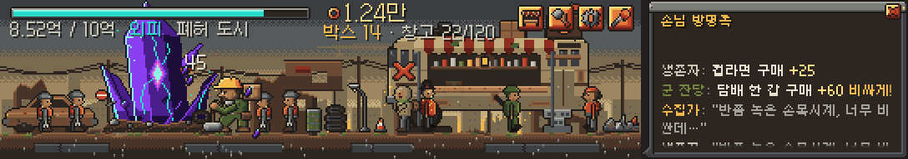
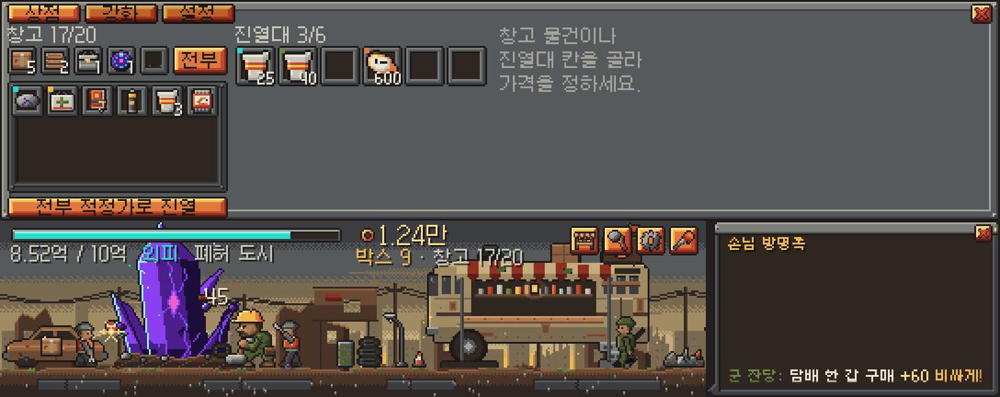
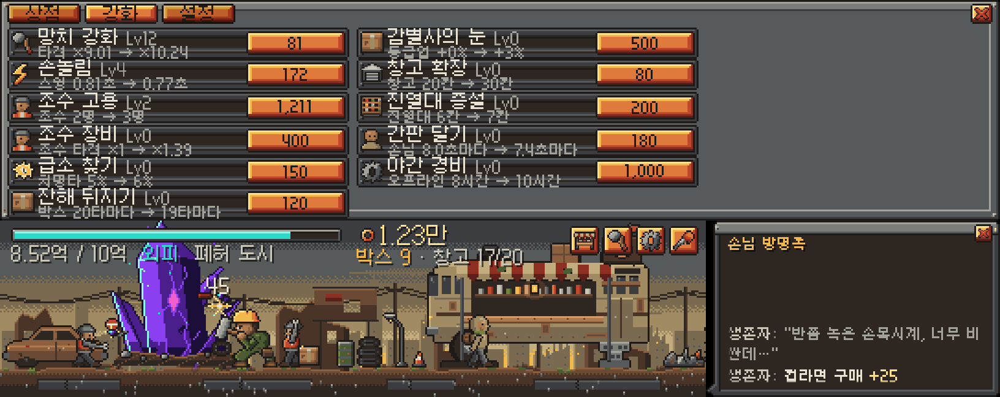

# 넥서스 부수기 (Nexus Breaker)

> 세상의 물자를 빨아들여 문명을 무너뜨린 **체력 10억짜리 넥서스**를 망치 든 수리공이 부수고,
> 쏟아져 나온 잡동사니를 폐버스 노점에서 **내가 정한 가격**에 팔아 다시 부수기에 투자하는
> 2D 도트 · 포스트 아포칼립스 **데스크톱 아이들러**.



화면 아래쪽에 띠처럼 붙어서 일하는 동안 곁눈질로 즐기는 게임입니다. 상점이나 강화를 열면 창이 위로 늘어나고,
오른쪽 **손님 방명록**에는 손님들의 한마디가 방송 채팅처럼 올라와요(끌 수 있음).

**[⬇ 베타 다운로드 (Windows)](https://github.com/imjunseoo/nexus-breaker/releases/latest)**

| 상점 — 창고 · 진열대 · 가격 정하기 | 강화 |
|---|---|
|  |  |

---

## 코어 루프

```
타격(클릭 + 자동) → 넥서스 HP↓ → 박스 드랍 → 박스 열기 → 진열 · 가격 책정
   → AI 손님 구매 → 너트(화폐) → 강화 → … → 넥서스 파괴 → 환생(다음 지역, HP ×10)
```

## 주요 기능

- **넥서스 부수기**: 클릭 타격, 수리공 자동 스윙, 조수(최대 5명), 치명타, 파손 5단계
- **지층**: 외피 → 압축층 → 내핵 → 코어. 깊이 팔수록 **외계 물건**이 나오지만 넥서스가 **단단해진다**(경도)
- **랜덤 박스 5등급 · 아이템 30종**: 과자 · 담배 같은 생필품부터 무중력 숟가락, 노래하는 두개골까지
- **상점 (게임의 핵심)**
  - 아이템에 마우스를 올리면 **시장가** 표시
  - 가격을 직접 입력 / 슬라이더 / %버튼으로 정한다
  - **싸게 → 빨리 팔림, 비싸게 → 느리지만 큰 돈, 터무니없이 비싸게 → 아주 가끔 수집가가 사 감**
  - 진열대 칸 수가 한정돼 있어서 "회전율 vs 마진"이 늘 고민거리
  - 칸마다 예상 판매 속도를 색 점으로 표시(즉시 · 빠름 · 보통 · 느림 · 매우 느림 · 기적)
  - **전부 적정가로 진열**: 창고 물건을 시장가로 빈 칸에 한 번에(칸이 모자라면 비싼 것부터)
- **손님 방명록**: 손님 반응과 알림이 게임 화면 밖 말풍선 패널에 최근 5개씩 쌓인다(× 또는 설정에서 끄기)
- **튜토리얼**: 첫 판매·첫 강화까지 화살표와 말풍선으로 안내(건너뛰기 가능)
- **AI 손님 8종**: 생존자, 떠돌이 상인, 약탈자, 군 잔당, 넥서스 교단, 수집가, 변장한 외계인 …
  각자 시장가 대비 지불의향(로그정규분포)과 선호 카테고리가 다르다
- **시세 변동 · 시장 이벤트**: 모래폭풍(방독면 ↑), 대정전(건전지 ↑), 교단 축제(외계 물건 ↑) …
- **강화 11종**, **환생(코어 영구 강화)**, **오프라인 진행 정산**, **자동 저장**
- **데스크톱 창**: 테두리 없는 띠 창, 항상 위, 투명 배경, 빈 곳 클릭 통과, 핀 버튼으로 창 끌기(옮긴 자리 기억, 여러 모니터 지원)
- **픽셀 폰트**: Galmuri(12/10/8px) — 칸에 안 들어가면 단계별로 자동 축소

## 판매 판정 (설계 메모)

손님이 진열대에서 최대 3개를 보고, 각 물건에 대해

```
지불의향 = 시장가 × 손님 타입 배수 × LogNormal(0, σ)
가격 ≤ 지불의향인 것 중 (지불의향 − 가격)/지불의향 이 가장 큰 물건 1개를 산다
```

일반 손님(σ 0.35) 기준 구매 확률: 0.5배 ~98% · 1.0배 50% · 1.5배 ~12% · 2배 ~2% · 3배 이상 ≈ 0 (수집가만 가끔)

## 밸런스

방치 봇(클릭 없음) 시뮬레이션으로 첫 넥서스(10억) 파괴까지 **약 29시간**이 걸리도록 맞췄습니다.

| 지층 | 도달 시간 | 경도(데미지 배율) |
|---|---|---|
| 외피 | 0h | ×1 |
| 압축층 | ~9.5h | ×0.2 |
| 내핵 | ~17h | ×0.045 |
| 코어 | ~24.5h | ×0.012 |

수치는 [`Assets/Scripts/Data/Stats.cs`](Assets/Scripts/Data/Stats.cs) 한 곳에서만 조정하고, 에디터 메뉴 `Nexus Breaker/Run Balance Simulation`으로 확인합니다. 결과: [Docs/BALANCE_SIM.md](Docs/BALANCE_SIM.md)

---

## 실행 방법

1. **Unity 6000.3.5f2** (2D URP)로 이 폴더를 연다.
2. `Assets/Scenes/Main.unity` → Play
   (Game 뷰 1152×288 또는 1152×648 권장. `GameRoot`의 *Fresh Start In Editor*로 새 게임, *Editor Time Scale*로 배속)
3. 처음 열었을 때 화면이 비면 메뉴 `Nexus Breaker/1. Setup Project` → `2. Wire Assets`

빌드는 Windows(D3D11 고정)를 기준으로 합니다. 투명·레이어드 창 방식이 D3D12와 맞지 않아서입니다.

자세한 개발 안내: [Docs/DEV_GUIDE.md](Docs/DEV_GUIDE.md)

## 프로젝트 구조

```
Assets/
  Scripts/
    Core/          큰 수 표기(만·억·조), 난수 분포, 세이브
    Data/          아이템·손님·강화·시장 이벤트 카탈로그, Stats.cs(밸런스 공식)
    Model/         GameModel — 게임 규칙 전체(순수 C#, Unity 의존 없음)
    Presentation/  GameRoot(진입점), 월드 연출, 코드로 만드는 uGUI, 오디오
    Platform/      DesktopWindow — Win32 창 제어(항상 위·투명·클릭 통과·끌기)
    Editor/        셋업, 에셋 자동 연결, Aseprite 임포트 규칙, 픽셀 폰트 생성, 밸런스 시뮬레이터
  Tests/EditMode/  모델 테스트
  Art/             .aseprite 원본(태그 = 애니메이션 상태명)
  Audio/           SFX · BGM · 앰비언스
ArtSource/         도트 생성 스크립트 · 팔레트 · 미리보기
AudioSource/       사운드 합성·작곡 스크립트 · 미리듣기 페이지
Docs/              기획서(GDD), 에셋 스펙, 아트·사운드 로그, 밸런스 결과
```

- 입력: **Input System + InputSystemUIInputModule** (구식 StandaloneInputModule 미사용)
- UI: uGUI + TextMeshPro, 모든 UI를 코드로 생성
- 아트: Aseprite 파일을 `com.unity.2d.aseprite`로 임포트 → 태그별 프레임 애니메이션
- 아트가 없는 상태에서도 플레이스홀더로 동작

## 문서

| 문서 | 내용 |
|---|---|
| [Docs/GDD.md](Docs/GDD.md) | 기획서 |
| [Docs/ASSET_SPEC.md](Docs/ASSET_SPEC.md) | 아트·사운드 스펙(파일명 · 크기 · 태그 · 32색 팔레트) |
| [Docs/ART_LOG.md](Docs/ART_LOG.md) | 도트 제작 로그 |
| [Docs/SOUND_LOG.md](Docs/SOUND_LOG.md) | 사운드 제작 로그 |
| [Docs/BALANCE_SIM.md](Docs/BALANCE_SIM.md) | 밸런스 시뮬레이션 결과 |

## 로드맵

- [x] 튜토리얼 · 손님 방명록 · 전부 적정가로 진열 (v0.1.1-beta)
- [ ] 도감 화면
- [ ] 수리공 도트: 직접 찍은 버전 vs PixelLab 버전 비교 후 확정
- [ ] 사운드 청취 검수 · 믹스 조정
- [ ] 넥서스 타격 번쩍임 셰이더, 지역별 넥서스 색 변형
- [ ] Steam 출시 준비(업적, 클라우드 세이브)

## 크레딧

- 폰트: [Galmuri](https://github.com/quiple/galmuri) © Lee Minseo — SIL Open Font License 1.1 (`Assets/Fonts/Galmuri/LICENSE.txt`)
- 도트 아트 · 애니메이션 · 사운드: 이 저장소의 `ArtSource/` · `AudioSource/` 스크립트로 제작
- 개발: Claude Code와 함께
